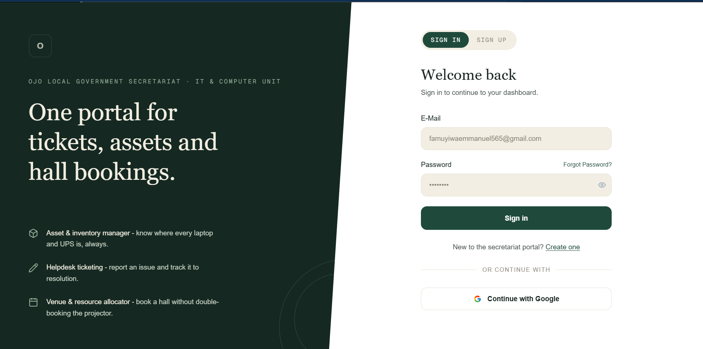
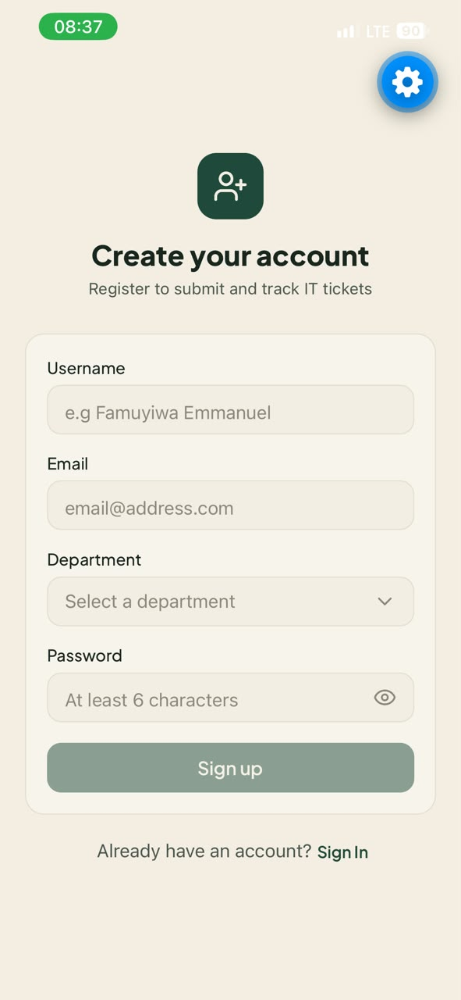
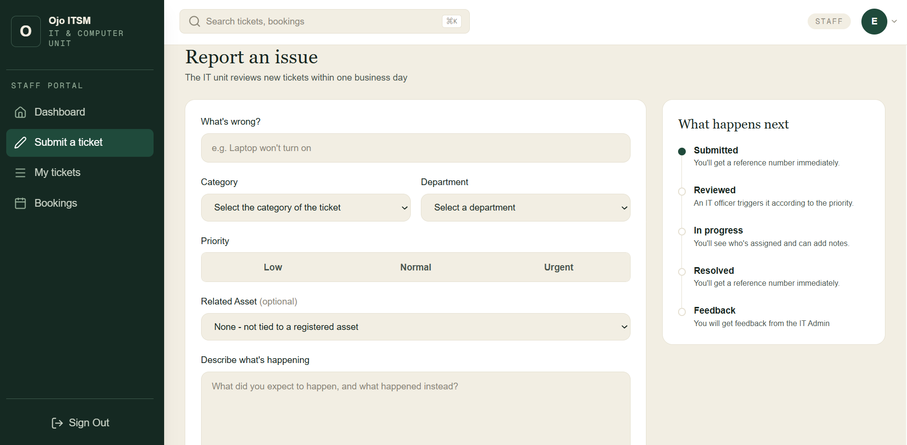
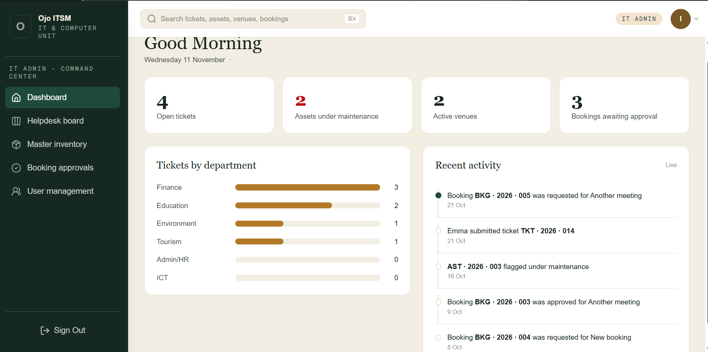
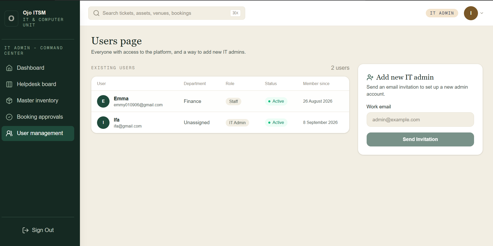

# Ojo ITSM – IT Service Management System

Ojo ITSM is a full-stack IT Service Management platform designed to streamline IT support operations within Ojo Local Government Secretariat.

The platform provides a centralized system for managing IT support tickets, equipment bookings, assets and staff requests. It helps improve communication between staff members and the IT department while making support operations easier to track and manage.

## Live Application

| Component       | Link                                                       |
| --------------- | ---------------------------------------------------------- |
| Web Application | [Ojo ITSM](https://itsm-dusky.vercel.app)                  |
| Backend API     | [Ojo ITSM Backend](https://itsm-backend-z6yu.onrender.com) |

## Application Screenshots

### Staff Web Dashboard



### Staff Mobile Dashboard



### Staff Ticket Booking



### IT Admin Dashboard



### IT Admin User Management



## Features

### Authentication and User Management

- Secure authentication powered by Supabase.
- Role-based access for staff members and IT administrators.
- Department-based user information.
- Separate dashboards for staff and administrators.

### Ticket Management

- Staff can submit IT support requests.
- IT administrators can view and manage reported issues.
- Administrators can claim and update tickets.
- Ticket status tracking.
- Ticket assignment and activity tracking.

### Equipment Booking

- Staff can request equipment bookings.
- Support for booking resources such as projectors, microphones and speakers.
- Booking management and status tracking.

### Asset Management

- Centralized management of IT equipment and resources.
- Equipment information and availability tracking.

### Activity Monitoring

- Activity logs for tracking important system operations.
- Real-time activity updates.
- Recent ticket and activity summaries.

### Cross-Platform Support

- Web application built for browser-based access.
- Mobile application built with React Native and Expo.

## Technology Stack

| Area                    | Technologies               |
| ----------------------- | -------------------------- |
| Frontend                | Next.js, React, TypeScript |
| Backend                 | Go (Golang)                |
| Database                | PostgreSQL                 |
| Authentication          | Supabase Auth              |
| Mobile                  | React Native, Expo         |
| Real-time Communication | Supabase Realtime          |
| Containerization        | Docker, Docker Compose     |
| Deployment              | Vercel, Render             |

## Project Structure

```text
itsm/
│
├── frontend/          # Next.js web application
│
├── backend/           # Go REST API
│
├── mobile/            # React Native mobile application
│
├── docker-compose.yml # Docker Compose configuration
│
└── README.md
```

## System Architecture

Ojo ITSM follows a client-server architecture.

1. The web and mobile applications provide interfaces through which users interact with the platform.
2. The Go backend handles API requests and business logic.
3. PostgreSQL stores application data.
4. Supabase Auth handles user authentication.
5. Supabase Realtime provides real-time activity updates.

## Getting Started

### Prerequisites

Before running the project locally, ensure you have:

- Node.js and npm
- Go
- PostgreSQL
- Docker Desktop (optional)
- A Supabase project

### 1. Clone the Repository

```bash
git clone https://github.com/Em-myy/itsm.git

cd itsm
```

### 2. Set Up the Backend

```bash
cd backend

go mod download
```

Configure the backend environment variables using the required values for your database and Supabase configuration.

Start the backend:

```bash
go run main.go
```

### 3. Set Up the Frontend

Open another terminal:

```bash
cd frontend

npm install
```

Configure the frontend environment variables, including the Supabase project URL and publishable key, as well as the backend API URL.

Start the development server:

```bash
npm run dev
```

The web application should now be accessible at:

```text
http://localhost:3000
```

### 4. Set Up the Mobile Application

```bash
cd mobile

npm install

npx expo start
```

Follow the Expo CLI instructions to launch the application on an emulator or physical device.

## Docker

The repository includes a Docker Compose configuration for containerized development.

From the project root, you can start the configured services using:

```bash
docker compose up --build
```

Ensure the required environment variables and service configuration are available before running the containers.

## Future Improvements

- Expanded reporting and analytics.
- Advanced ticket prioritization.
- Improved notification management.
- Additional asset tracking capabilities.

## Author

**Emmanuel Famuyiwa**

Full-Stack Developer | Backend Engineering | Cybersecurity Enthusiast

GitHub: [@Em-myy](https://github.com/Em-myy)

---

_Ojo ITSM – Simplifying IT support and service management._
